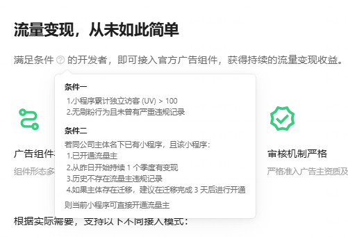
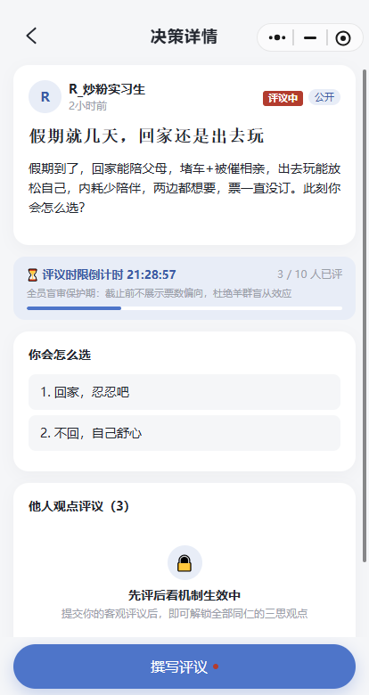

# 流量主门槛从 500 降到 100，我的小程序上线 18 小时够到了线

今天早上打开后台，「流量主」那一页的条件一变了：



**小程序累计独立访客（UV）> 100**。

我盯着那个数字看了大概半分钟。因为前一阵我为这个数专门写过一篇，当时它是 500，我以为至少要几个月才能磨过去。

顺手核了一下口径，免得写文章把人说晕：微信官方的商业能力文档、腾讯客服的流量主开通流程页，现在写的仍然是「UV 500 以上」；后台实际点亮按钮的门槛已经变成 100。这种不一致以前也碰到过，我的结论还是一句：**别信文章，也别信文档，信你后台那个按钮是不是绿的。**

## 众三思是个什么东西

一句话：把「帮我拿个主意」这件事结构化。

你写一份决策单——标题、背景、2 到 6 个候选项，可以配图，设一个评议时限和人数上限，然后丢给别人。别人选一个倾向、写一段自己的推演。规则里有两条是我坚持要做的：

一条是**先评后看**。你不写自己的观点，就看不到别人怎么想的。想白嫖别人的判断，不行。

另一条是**截止之前不露票数**。一份「要不要接这个 offer」的决策单，如果一开始就显示 7 个人选了 A，剩下的人基本就跟着走了。它要的是不同的看法，不是复读。



到期或者满员就出报告，发起人再回填一个真实结局：当时听了谁的话，最后怎么样了。这个产品我最想要的其实是最后那一步，前面所有环节都是为它服务的。

技术栈没什么可说的，原生小程序 + Spring Boot 单体 + MySQL + Redis，后端堆内存给到 512M 就跑在线上了，图片走七牛。

## 18 小时是怎么过去的

我把线上的数据拉出来核了一遍，时间线很清楚：

- 11 月 2 日 16:51，正式版上线后的第一个访客建档
- 11 月 2 日全天：19 个人
- 11 月 3 日 10:46，第 100 个访客出现
- 11 月 3 日 11:57 我查的时候，累计 136 个人

从第一个到第一百个，**17 小时 55 分**。

（这里有个口径要交代：小程序一打开就会静默登录建档，所以 `user` 表的行数约等于来过的独立访客数。微信到底按什么维度去重、清数据换手机算不算两个人，官方没写，我不猜。后台的 UV 以截图为准。）

顺带说一个可能的坑：流量主资格是次日刷新的。今天我看见达标了，按钮真正能点大概是明天。所以我现在写的是「达到开通条件」，不是「我已经开通」，这两件事别混。

## 为什么是 18 小时，而不是因为它好

我不想把这段写成复盘成功学。真实原因只有一个：**这个产品的用法本身就要求你把链接递出去。**

一份决策单，发起人自己点是没有任何意义的——它必须被第二个人、第三个人打开才算数。所以「分享」不是我在功能外面挂的一个增长钩子，它是产品内部绕不过去的一步。你发起了，就得找人；找了人，人就得点开。

我做的时候刻意守住了一条线：

- 危险的做法：分享到三个群解锁功能、转发才能看别人的观点、拉人才能扩容
- 我的做法：你想看别人的判断，你就得先给出自己的判断

前者是交易，后者是需求。而且这不只是道德问题——「诱导分享」在小程序运营规范里是明写的红线，一旦被判，留下的是**违规记录**，而开通条件里那半句话就挂着「无刷粉行为且未曾有严重违规记录」。辛苦攒的访客数抵不过一次判定，这个买卖我不做。

所以任务、助力、转发解锁这些东西，一个都没上。100 个访客全部是靠有人真的想找人商量事、把决策单发出去换来的。

## 门槛降到 100，到底改变了什么

对个人开发者来说，500 和 100 不是「少 400 个」的关系，它们卡的是完全不同的东西。

500 意味着你**必须得有外部流量**。产品自己带不来这么多人的时候，你得去发帖、去混群、去找渠道，本质上考的是运营能力。很多人功能做完，卡在这一步，然后就放弃了。

100 意味着**产品自己带得动就能过线**。一份决策单发到群里，群里十几个人点开，这就快一半了。它考的东西从「你会不会拉新」变回了「有没有人愿意点开你的东西」。

我觉得这个变化对工具类、协作类的小程序是好事。但也不要把门槛降低理解成「微信要给大家发钱了」：

- 条件二那条（同公司主体名下已有小程序、持续变现满一个季度、无违规）一点没松，说明准入的审核逻辑还在
- 100 也让凑数变得更容易了，微信大概清楚这一点，所以后面还有广告位审核和收入门槛在那儿等着

门槛往下挪一格，只是把「能不能开始」这个问题解决了。能开始，不等于能活。

## 达标之后我看了一眼更难看的数据

因为这篇要写数字，我把几张表都拉了一遍，然后被自己浇了盆冷水。

- 31 份决策单里，只有 **12 份**收到过评议，一共 17 条
- 31 份决策单**全部是公开档**，群组一共 1 个、9 名成员
- 也就是说，来的人大多在广场上逛、顺手评一条，真正把同事朋友拉进来一起想一件事的，几乎没有

这跟我的预期是反的。我以为群内评议会是主场景，结果大家更愿意在广场上看别人的两难。


所以流量主这件事对我来说的真实位置是：它证明「有人愿意点开」，但它完全不证明「有人留下来」。UV 是敲门砖，评议率才是这个产品要的东西。100 个人来了，其中多少人认真写了一段话——目前答案是 17 条评议摊在 31 份决策单上。

## 广告位我打算怎么放

到现在一个广告位都还没埋，代码里干净。

想放的位置只有两个：众思广场列表底部，和决策报告页的底部。理由是这个两处是「逛」和「看完」的场景，中间的操作路径（写评议、发起决策单、回填结局）我一点都不想让广告插进去。这个产品最值钱的东西就是那几分钟认真写字的时间，为了几毛钱的 eCPM 把它打断，不划算。

明天按钮亮了我会先开通、把结算信息填了，但广告位开不开、什么时候开，我想再看一周数据。

## 附：想自己核一遍的，一条 SQL 就够

如果你的小程序也是打开即建档，可以直接数用户表：

```sql
-- 每天来了多少新面孔
SELECT DATE(created_at) AS d, COUNT(*) AS new_users
FROM user
GROUP BY d
ORDER BY d DESC;
```

按天看比看总量有用得多。总量告诉你离门槛还有多远，按天的曲线告诉你：**这东西是自己会长人，还是只能靠你到处递链接。**

## 最后

「要不要接这个 offer」「孩子要不要报这个班」，这种话你在群里丢出去，收回来的是七嘴八舌，不是一份能留住的记录。众三思想做的就是把它留下来：谁选了什么、为什么这么想、你最后到底怎么选的、结果怎么样。

正好有件事拿不定主意，可以扫下面这个码进去看看别人是怎么吵的，也可以自己发一份。


---

> 【配图待补】
> - `./images/02-后台uv趋势.png`：小程序后台「数据分析 - 独立访客(UV)」11-02 / 11-03 曲线，插在「18 小时是怎么过去的」那一节的时间线下方
> - `./images/03-流量主开通页.png`：后台「流量主」页按钮点亮 / 开通成功那一屏，插在开头那张条件图之后
